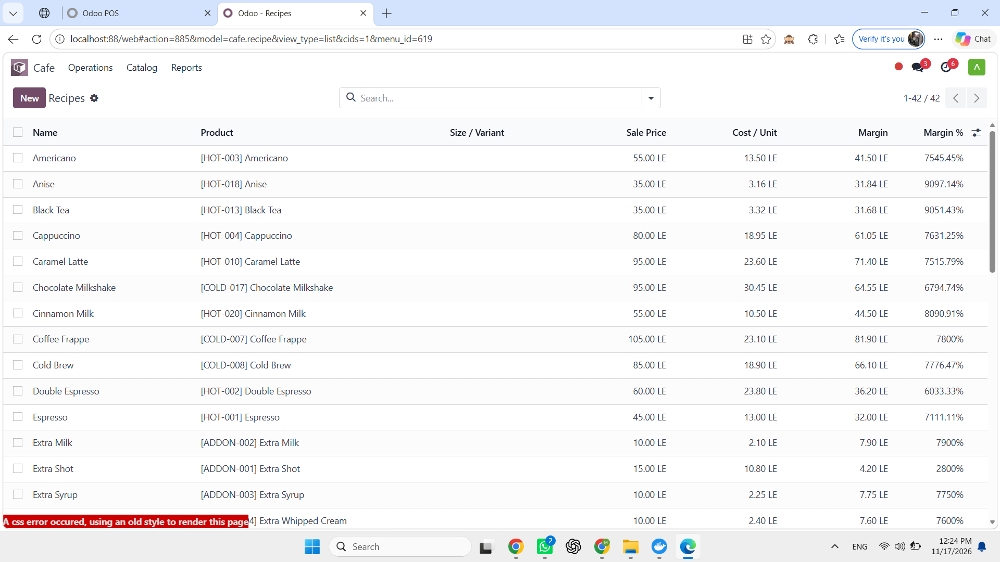
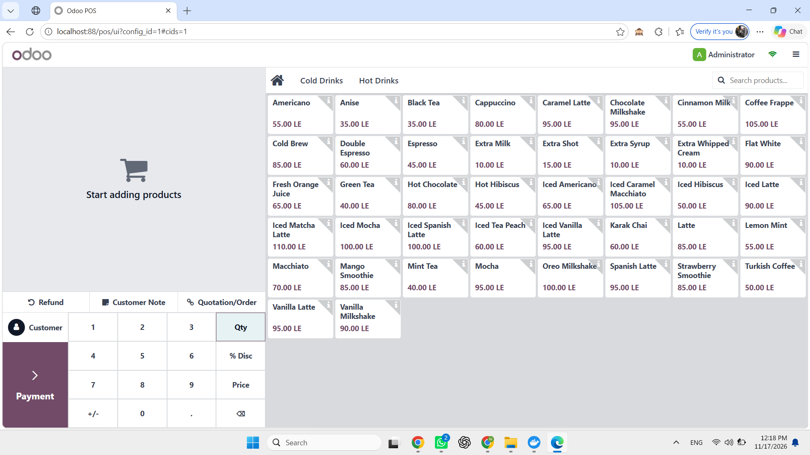
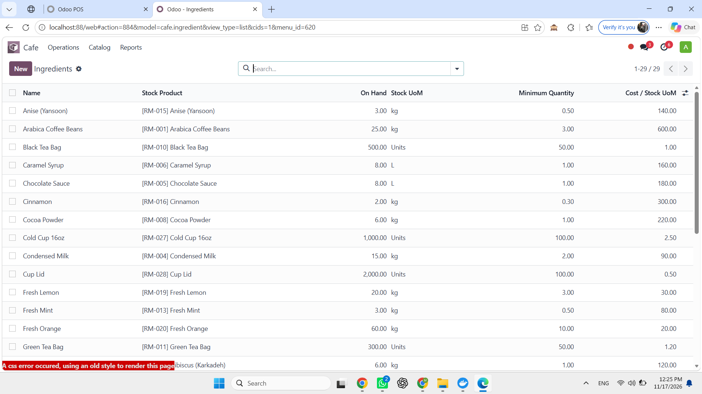
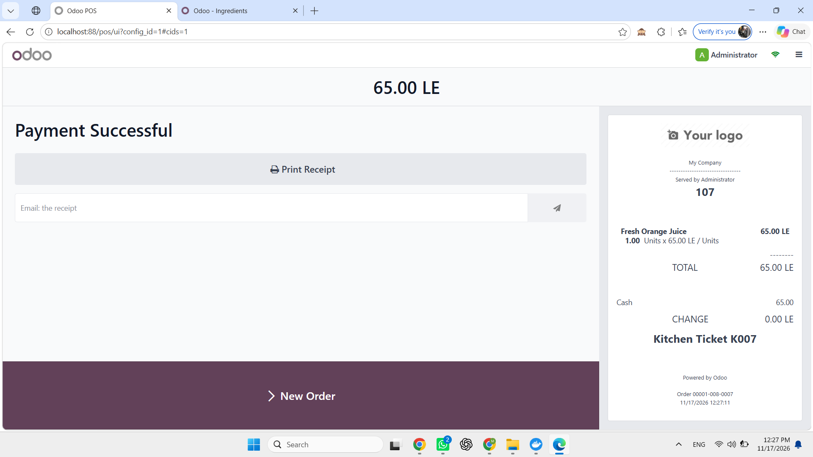

# ☕ Cafe Management System – Odoo 17

An Odoo 17 custom module designed to support cafe operations, including recipe management, ingredient tracking, Point of Sale (POS) integration, and inventory management.

## 📌 Project Overview

The Cafe Management System helps organize daily cafe operations through Odoo 17.

It connects recipes with their ingredients and integrates with the Point of Sale workflow to support ingredient consumption tracking after successful customer payments.

This project was developed as a practical learning experience in Odoo module development and customization.

## ✨ Key Features

- **Recipe Management:** Create and manage cafe recipes and their ingredients.
- **Ingredient Management:** Track ingredients and related inventory information.
- **POS Integration:** Connect cafe operations with the Odoo Point of Sale system.
- **Ingredient Consumption:** Deduct recipe ingredients after successful POS payments.
- **Duplicate Deduction Prevention:** Help prevent ingredients from being deducted more than once for the same transaction.
- **Kitchen Orders:** Support kitchen order workflows and kitchen display functionality.
- **Inventory Tracking:** Track stock movements and ingredient availability.
- **Low Stock Alerts:** Help identify ingredients that need replenishment.
- **Waste Management:** Support tracking of wasted ingredients.
- **Cost and Profit Analysis:** Provide information to help analyze recipe costs and profitability.
- **Security:** Use Odoo security groups and access permissions.
- **Automated Tests:** Include tests for important module functionality.

## 🔄 Main Workflow

1. Create ingredients and manage their inventory.
2. Create recipes and assign the required ingredients and quantities.
3. Configure products in the Point of Sale.
4. Process a customer order through the POS.
5. After successful payment, calculate the required ingredient quantities.
6. Update ingredient consumption and inventory movements.
7. Monitor stock levels and review cafe operations.

## 🛠️ Technologies Used

- Python
- Odoo 17
- PostgreSQL
- XML
- JavaScript
- Odoo ORM
- Odoo Point of Sale
- Git and GitHub

## 📂 Project Structure

```text
cafe_management/
│
├── models/
├── views/
├── security/
├── static/
│   └── src/
├── report/
├── tests/
├── data/
├── demo/
│
├── __init__.py
├── __manifest__.py
└── README.md
```

## ⚙️ Installation

### Requirements

- Odoo 17
- PostgreSQL
- Python environment compatible with Odoo 17

### Steps

1. Clone the repository:

```bash
git clone https://github.com/Ahmed-Ibrahim023/odoo-cafe-management.git
```

2. Copy the `cafe_management` module folder into your Odoo 17 custom addons directory.

3. Make sure your Odoo configuration includes the custom addons path.

4. Restart the Odoo server.

5. Activate Developer Mode.

6. Go to **Apps** and click **Update Apps List**.

7. Search for **Cafe Management** and install the module.

## 📸 Application Screenshots

### 1. Recipe Management

Manage cafe recipes and their ingredients, including products such as Americano and Anise.



### 2. Point of Sale (POS)

A cashier interface for selecting products and processing customer orders.



### 3. Ingredients Management

Manage ingredients and inventory items, including Anise and Arabica Coffee Beans.



### 4. Payment Confirmation & Receipt

Display the successful payment confirmation and receipt after completing a POS transaction.



## 🧪 Testing

The project includes a `tests/` directory for automated testing.

Tests can be executed using the Odoo test runner. For example:

```bash
odoo --addons-path=addons,custom_addons \
     -d cafe_test_db \
     -i cafe_management \
     --test-enable \
     --stop-after-init
```

Replace `custom_addons` with your actual custom addons path.

## 🧠 Development Notes

This project explores practical Odoo development concepts, including:

- Custom Odoo models and fields.
- ORM methods and business logic.
- Model relationships.
- XML views and menus.
- Security groups and access control.
- POS workflow customization.
- Inventory operations.
- Automated testing.

## 👨‍💻 Author

**Ahmed Mohamed Ibrahim**

Aspiring Python | Odoo | AI Developer

- GitHub: [Ahmed-Ibrahim023](https://github.com/Ahmed-Ibrahim023)
- LinkedIn: [Ahmed Mohamed Ibrahim](https://www.linkedin.com/in/ahmed-m-ibrahim-435646351/)

## 🤖 AI Assistance

This project was developed with AI assistance using Claude.

It is part of my practical learning journey in Odoo development, with a focus on understanding the code structure, business logic, module architecture, and customization workflows.

## 📄 License

This project is licensed under the LGPL-3.0 License, as specified in the module manifest.
